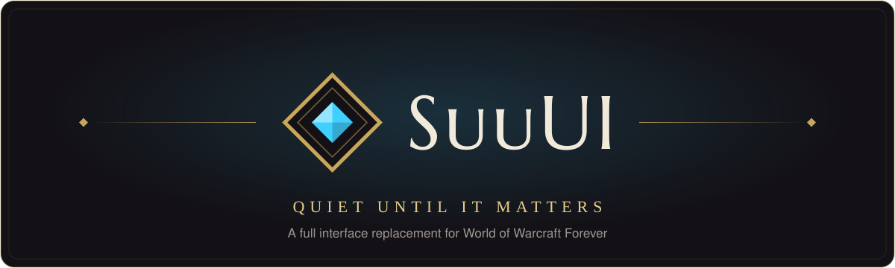

<p align="center">
  
</p>

<p align="center">
  
  
  
  
  <a href="LICENSE"></a>
  <a href="https://discord.gg/JkdTrRXdDw"></a>
</p>

<p align="center">
  <b>A full interface replacement for World of Warcraft Forever.</b><br>
  One design system, every frame rebuilt from scratch, and nothing on screen that doesn't earn its place.
</p>

<p align="center">
  <a href="#-features">Features</a> ·
  <a href="#-installation">Installation</a> ·
  <a href="#-getting-started">Getting started</a> ·
  <a href="#-roadmap">Roadmap</a> ·
  <a href="#-for-developers">For developers</a> ·
  <a href="https://discord.gg/JkdTrRXdDw">Discord</a>
</p>

---

## ✦ What is SuuUI?

SuuUI replaces the default interface of **WoW Forever** — the classic-era game running on the modern engine — with a single, consistent UI. Unit frames, group frames, nameplates, action bars, cooldowns, casts and auras all share one visual language: dark glass surfaces, gilt hairlines, ivory text, and **arcane blue reserved for what is ready or actionable right now**.

Its guiding idea is in the tagline: **quiet until it matters**. Frames stay calm and legible; colour, glow and motion appear only when something needs your attention — a cooldown coming ready, a dispellable debuff on your tank, a cast you can interrupt.

It is built for the realities of the modern client: values the game hides from addons in combat (*secret values*) are never read, only handed to the engine to draw. That keeps SuuUI working in combat, in dungeons and in raids, where many older approaches break.

<table>
  <tr>
    <td width="33%" valign="top">
      <h3>◆ One design system</h3>
      Every colour, size, font and motion comes from shared design tokens. Nothing is styled ad hoc, so every part of the UI reads the same way.
    </td>
    <td width="33%" valign="top">
      <h3>◆ Modular</h3>
      Every feature is a module you can switch off, and Blizzard's own frame comes back. Plugins use the very same public API as the built-in modules.
    </td>
    <td width="33%" valign="top">
      <h3>◆ Combat-safe</h3>
      Designed around secret values and protected frames from day one: no taint, no errors in combat, nothing that breaks when you pull.
    </td>
  </tr>
</table>

---

## ✦ Features

### Frames
| | |
|---|---|
| **Unit frames** | Player, target, target of target, focus, pet and boss frames. Health text as percent, value, both or none; a gradual low-health tint; incoming heals and absorbs; debuff-type borders and badges; raid target markers; offline state; adjustable size. |
| **Party & raid frames** | Secure group frames for 5, 10, 20 and 40 players, with real-size previews right in the settings. Debuffs you can remove shown by type even in combat, aggro, range fading, class-coloured names and sorting by role. Defensives and debuffs as separate groups beside each bar. |
| **Defensives** | A list you control of the buffs that count as defensives (Blessing of Protection, Shield Wall, Ice Block…), every rank: they show beside party and raid frames, and the big ones mark the frame **Warded** with a badge and border, in combat too. |
| **Buff indicators** | Healer indicators per class and spec: icons, squares, borders or fills in any corner, shown while up or while missing, scoped to your own group or the whole raid, per raid size. |
| **Nameplates** | Enemy plates with your debuffs, threat badges (solo and in groups), casts with spell icon, target and interrupt state, quest objective marks and raid markers. Styled friendly plates in the open world. |
| **Cast & swing bars** | Your cast bar with its target, target / focus / boss casts that show whether you can interrupt them, and a swing timer that follows your cast bar. |
| **Auras** | Your buffs and debuffs, and your auras on other frames, drawn by the engine so they stay correct in combat. |

### Combat
| | |
|---|---|
| **Action bars** | A dock for bars 1–4 plus bars 5–8, stance and pet bars, visibility rules (always, in combat, on mouseover), and a keybind mode: hover a button, press a key. |
| **Cooldown Manager** | SuuUI's own cooldown and aura tracker with ready-made presets for **every class and spec**. Shared slots (one icon for several spells, or the best spell you know), collections, reminders for missing buffs, effects shown on cooldown icons, sounds — and **conditions** on anything: group or raid, classes in your group, role, stance or form, combat, instance, target type and talents. |
| **Alerts & threat** | Alerts for threat and aggro, and for being about to pull. A threat meter for your group. A pull countdown on the game's own countdown, so your whole group sees it, with or without a boss mod. |
| **Damage meter** | Damage, healing, interrupts, dispels, deaths and more, per fight or overall, on the game's own combat data. |
| **Encounter timeline & readiness** | Boss abilities riding toward "now", also from DBM or BigWigs timers. A readiness panel showing whose big cooldowns are ready before the pull. |

### Everyday
| | |
|---|---|
| **Chat** | Tabs, message categories, a global panel for public channels, conversations and a cleaner input field. |
| **Minimap & micro menu** | SuuUI's own minimap and micro menu, with the Jewel. |
| **Bags** | Bags and bank with sorting, a search across all your characters, and selling junk at a vendor. |
| **Objective tracker** | Quests with their objectives and quest items, plus tracked profession recipes. |
| **Notifications** | One stack for repairs, full bags, ready checks, loot rolls, requests, battlegrounds, and friends and guild members coming online. |
| **Loot & tooltips** | The loot window and loot rolls, and the game's tooltips in SuuUI's look. |
| **Campsite** | Alerts for Campfire's camp benefits. |
| **Settings window** | Searchable, every change live, previews at real size, plain-language descriptions. |
| **Edit mode** | Move every SuuUI frame on a snap grid; reset one frame or all of them. |
| **Profiles** | Any number of profiles, switched automatically by your role, with import and export. |

### Windows
| | |
|---|---|
| **Character** | Forever's character window in SuuUI's look, with its stats and every tab. |
| **Spellbook & talents** | A spellbook that shows cooldowns and the spells you can train. A talent picker. A level-up card with your new spells. The Legacy window. |
| **Professions** | SuuUI's own professions window: your professions at a glance, recipe lists with filters, where each recipe is learned, and tracking. |
| **Social** | Friends, recent allies and friend requests. Raid groups where you drag members between groups. |
| **Guild** | Guild chat with the message of the day. A roster with class, notes and member details. Guild information and the guild log. Guild settings: ranks, permissions, bank tabs. |
| **World map** | Opens enlarged in the middle of the screen with your quest log beside it, or small under the micro menu. Pins for what's around you: quests you can pick up (and quests started by dropped items), dungeon and raid entrances with their levels, flight masters, services, trainers, rares and treasures, holiday quests while the holiday is on, and unexplored areas. Your quests' markers in SuuUI's look. Map filters in its header. |
| **Map marks** | Your own marks on the map and minimap (Ctrl+click): a name, one of eight symbols, the game's navigation arrow to them, and posting them to your group. |
| **Group Finder** | One list of groups and players looking for groups, from the game's group finder and from public chat in English, Korean and Chinese; what each group has and still needs. List yourself in SuuUI's look, My listing with a chat ad, Who, notes for groups that need you, and its own settings. |

---

## ✦ Installation

> **Requirements:** the WoW Forever client (interface `16001`).

1. Install **SuuUI** from **CurseForge** or **Wago Addons** (search for SuuUI in either app), or download the zip from [GitHub Releases](https://github.com/DomenikIrrgang/suuui/releases) and unpack it into `<World of Warcraft>/_classic_beta_/Interface/AddOns`.
2. Start the game (or type `/reload`) and make sure **SuuUI** is enabled in the AddOns list.
3. Type **`/suu`** to open the settings.

### From source

This repository is the source, not the addon itself. It is built with [wowlua](https://wowlua.dev):

```sh
git clone git@github.com:DomenikIrrgang/suuui.git
cd suuui
wowlua install --release   # builds SuuUI and installs it into your game's AddOns folder (--wow <path> to name it)
```

`wowlua dev` rebuilds and installs on every change; then `/reload` in game.

---

## ✦ Getting started

| Command | What it does |
|---|---|
| `/suu` | Open or close the settings window |
| `/suu edit` | Edit mode: move SuuUI's frames on a snap grid |
| `/suu keybind` | Keybind mode: hover an action button and press a key |
| `/suu pull [seconds]` | Start a pull countdown (`0` cancels) |
| `/suu modules` | List every module (built in and from plugins) with its state |
| `/suu enable <id>` · `/suu disable <id>` | Turn a module on or off |
| `/suu profile` | Show profiles · `use`, `new`, `delete <name>` |
| `/suu get` · `/suu set` · `/suu reset` | Read, change or reset any setting from chat |
| `/suu errors` | List the errors SuuUI caught this session |
| `/suu version` | Show the SuuUI and client versions |
| `/suu help` | Every command |

**First steps:** open `/suu`, pick your preferences under **General → Appearance**, place your frames with **Edit layout**, and load your spec's preset in **Frames → Cooldown Manager**. Under **General → Profiles** you can set a profile per role (tank, healer, damage) — SuuUI switches when your role changes.

**Questions, bugs or ideas?** Join the [SuuUI Discord](https://discord.gg/JkdTrRXdDw): ask in #help, report in #bug-reports, share your setup in #ui-showcase, and get a ping when a new version is out.

---

## ✦ Roadmap

SuuUI is built in small increments, each one confirmed in game before the next begins. The full plan lives in [`IMPLEMENTATION_PLAN.md`](IMPLEMENTATION_PLAN.md).

| Phase | Content | State |
|---|---|---|
| **0 · Foundation** | Tokens and fonts, core services, module system and plugin API, primitives, settings window, edit mode | ✅ Done |
| **1 · Combat HUD** | Unit frames, cast bars and swing timer, auras, action bars, Cooldown Manager, party and raid frames, nameplates, alerts and threat meter, damage meter, encounter timeline and readiness | ✅ Done |
| **2 · World & everyday play** | Minimap, chat, objective tracker, notifications, bags and bank, loot, tooltips, campsite | ✅ Done |
| **3 · Blizzard windows** | Character, spellbook, talents and Legacy, professions, social and guild | ✅ Done |
| | Group finder | ✅ Done |
| | World map, quest log and map pins | ✅ Done |
| | Mail, merchant, trainer, auction house, collections | 🔷 Next |
| **4 · Depth & release** | Density and accessibility presets, performance and taint pass, plugin developer kit, release | ◇ Planned |

---

## ✦ For developers

SuuUI is meant to be extended. Every built-in module is written against the same public API a plugin uses, so a plugin can do anything the core modules do.

- **Plugin API:** [`Docs/API.md`](Docs/API.md) — modules, settings and migrations, the settings window, edit mode, events, components (unit frames, cast bars, aura containers, …) and design tokens.
- **Example plugin:** [`Examples/SuuUI_HelloPlugin`](Examples/SuuUI_HelloPlugin) — a minimal module with its own settings section.
- **Group finder library:** [`Docs/ForeverLFG.md`](Docs/ForeverLFG.md): `SuuUI.LFG`, the game's group finder and public chat as one list, with events. SuuUI's Group Finder is built on it the way a plugin would be.
- **Diagnostics:** `/suu probe` checks which client APIs SuuUI relies on. Further probes (`/suu probe <topic>`) record what the live client allows, from spells and talents to the group finder and the guild.

<details>
<summary><b>Project layout</b></summary>

```
suuui/
├── src/
│   ├── Core/         tokens, fonts, events, settings & profiles, modules, roles, public API
│   ├── UI/           components: unit frame, cast bar, action button, windows, roster, group finder, …
│   ├── SettingsUI/   the settings window and its sections
│   ├── EditMode/     moving frames on a snap grid
│   ├── Units/        the built-in modules (frames, bars, chat, bags, windows, guild, group finder, …)
│   ├── Libs/         ForeverLFG, the group finder library
│   ├── Data/         generated data: Cooldown Manager presets, talents, the aura catalog, recipe sources
│   └── Diagnostics/  probes that read the live client
├── Media/            fonts, textures and sounds
├── tools/            generators for the presets and data, the chat parser replay (run with Lua)
├── Docs/             API documentation, the ForeverLFG design, README assets
├── Examples/         a sample plugin
└── wowlua.json       the build: TOC fields, assets, release profiles and publish targets
```
</details>

<details>
<summary><b>Cooldown Manager presets</b></summary>

The presets are written as spell names in [`tools/presets/<CLASS>.lua`](tools/presets) and turned into spell IDs by `lua tools/gen_presets.lua`, using data read from the client itself (every rank, Forever's own spells, talent descriptions, trainer data and spell art). A name the client doesn't know stops the generator, a spell tracked twice is reported, so nothing unverified reaches the game.
</details>

---

## ✦ License

SuuUI is released under the [MIT License](LICENSE). The bundled typefaces keep their own license, the SIL Open Font License 1.1.

## ✦ Credits

- Typefaces: **[Figtree](https://github.com/erikdkennedy/figtree)** and **[Marcellus SC](https://fonts.google.com/specimen/Marcellus+SC)**, both under the SIL Open Font License (see [`Media/Fonts`](Media/Fonts)).
- Quest and map data: **[QuestieDB](https://github.com/Questie/QuestieDB)**'s Forever data (where quests are picked up, what they ask, town services, rares and treasures), generated into [`src/Data`](src/Data) by [`tools/gen_quest_starts.lua`](tools/gen_quest_starts.lua).
- Trainer data: **[cMaNGOS classic-db](https://github.com/cmangos/classic-db)** (GPL-3.0), Classic's profession recipes and what each weapon master teaches.
- Countdown voices: generated for SuuUI with [Kokoro-82M](https://huggingface.co/hexgrad/Kokoro-82M) (Apache 2.0) by hexgrad; see [`Media/Sounds/Countdown`](Media/Sounds/Countdown).
- Made for the **WoW Forever** community.

<p align="center">
  <br>
  
  <br>
  <sub>World of Warcraft is a trademark of Blizzard Entertainment, Inc. SuuUI is a fan-made addon and is not affiliated with or endorsed by Blizzard Entertainment.</sub>
</p>
